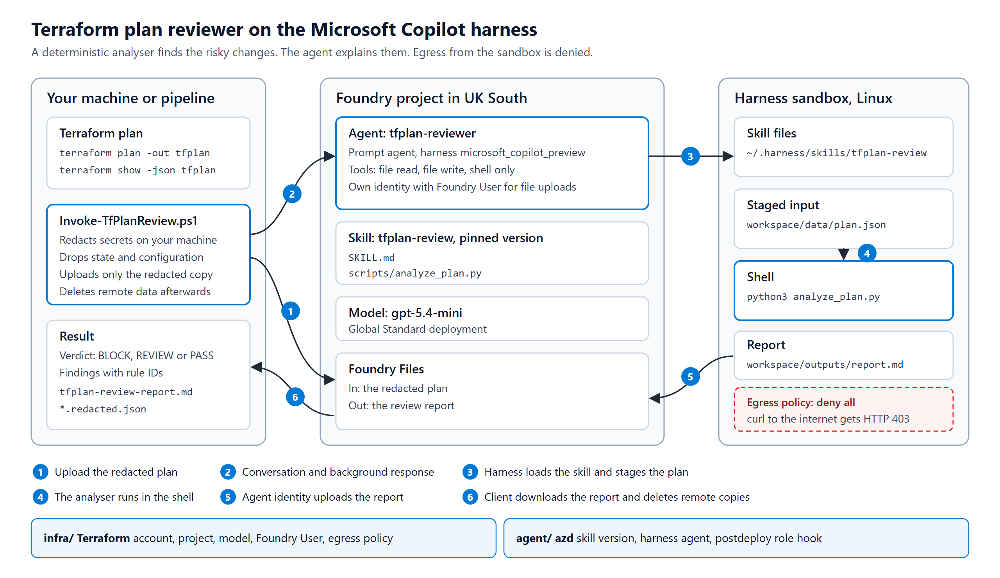

# getpractical-copilot-harness-lab

A Terraform plan reviewer built on the Microsoft Copilot harness in Foundry Agent Service, which is
in public preview. You give it the output of `terraform show -json`. A deterministic Python analyser
runs inside the harness sandbox and finds risky Azure changes, the agent explains each one and
suggests a fix, and you get a report with a verdict of BLOCK, REVIEW or PASS.

This is the companion lab for the getpractical.co.uk post "Reviewing Terraform plans with the
Microsoft Copilot harness in Foundry". The post explains the design. This file gets you running.



## What is in the repository

| Folder | Contents |
| --- | --- |
| `infra/` | Terraform for the Foundry account, project, `gpt-5.4-mini` deployment, Foundry User role and the egress policy |
| `agent/` | azd project that publishes the `tfplan-review` skill and creates the `tfplan-reviewer` harness agent |
| `agent/skills/tfplan-review/` | `SKILL.md` and `scripts/analyze_plan.py`, the analyser that runs in the sandbox |
| `client/` | PowerShell module and `Invoke-TfPlanReview.ps1`, which redacts a plan, runs the review and cleans up |
| `demo/` | A small workload that produces a safe plan and a risky plan to review |
| `tests/` | Python, Pester and live tests, plus sanitised real plans in `tests/fixtures/` |
| `scripts/` | `Sync-AzdEnv.ps1` copies Terraform outputs into azd. `Invoke-LabTests.ps1` runs every test |

## Prerequisites

- An Azure subscription where you can create resource groups, Foundry resources and role assignments.
- Azure CLI, signed in with `az login`.
- Terraform 1.9 or later. Tested with 1.14.9, azurerm 5.12.0 and azapi 2.13.0.
- PowerShell 7.4 or later and Pester 5 or later.
- Python 3.9 or later. The analyser uses only the standard library.
- azd 1.37 or later with the Foundry extensions. Tested with azd 1.37.2, `azure.ai.agents` 1.0.0-beta.23 and `azure.ai.skills` 1.0.0-beta.10.

```powershell
winget install microsoft.azd
azd extension install microsoft.foundry
azd config set auth.useAzCliAuth true
$env:AZD_ALPHA_ENABLE_AGENTS_MANAGED_HARNESS = 'true'   # set this in every new shell
```

The harness runs in Australia East, Canada Central, Central US, Germany West Central, Japan East,
Sweden Central, UK South, West Europe and West US. The lab defaults to UK South.

## Quick start

```powershell
# 1. Platform
cd infra
Copy-Item terraform.tfvars.example terraform.tfvars   # set subscription_id
terraform init
terraform apply
cd ..

# 2. Skill and agent
./scripts/Sync-AzdEnv.ps1
cd agent
azd deploy --all --no-prompt
cd ..

# 3. A plan to review
cd demo
Copy-Item ../infra/terraform.tfvars.example terraform.tfvars   # set subscription_id
terraform init
terraform apply                                  # the safe baseline
terraform plan -var scenario=risky -out tfplan   # never apply this one
terraform show -json tfplan > plan.json
cd ..

# 4. Review it
./client/Invoke-TfPlanReview.ps1 -PlanPath ./demo/plan.json
```

The client writes the redacted copy of the plan, the raw response and the agent's report to
`outputs/`. By default it then deletes the uploaded plan, the report and the conversation from
Foundry. Pass `-KeepRemoteData` to keep them. Pass `-RequiredTags environment, owner, cost-centre`
to change the tags the analyser expects.

To review the committed sample plan without deploying the demo workload:

```powershell
./client/Invoke-TfPlanReview.ps1 -PlanPath ./tests/fixtures/plan-risky.json
```

## Tests

```powershell
./scripts/Invoke-LabTests.ps1         # offline, no Azure calls
./scripts/Invoke-LabTests.ps1 -Live   # also tests the deployed lab
```

| Suite | Count | What it checks |
| --- | --- | --- |
| Python analyser tests | 32 | Every rule, the verdict logic, output formats, real plans and a check that fixtures hold no real Azure IDs |
| Pester unit tests | 40 | Redaction, response parsing and REST calls with HTTP mocked |
| `terraform test` in `infra/` | 8 | Naming, Entra-only auth, model, role scope and egress defaults, with mocked providers |
| Pester live tests | 22 | Agent definition, full reviews compared with the local analyser, cleanup and the egress block |

The live egress test asks the agent to run `curl` against the internet and expects HTTP 403. Set
`egress_mode = "Audit"` and the same test fails, because the request then gets through.

## Things to know

- The harness is in preview. You choose it when you create an agent and cannot add it to an existing one.
- The harness runtime is free until 1 December 2026. After that, sandbox compute costs USD 0.0994 per vCPU-hour and USD 0.0118 per GiB-hour. Model tokens are extra. One review used about 70,000 input tokens and took 30 to 40 seconds.
- The agent has the shell tool, so turning off the file and web tools is not a security boundary. The egress policy in `infra/egress-policy.tf` blocks direct outbound traffic from the sandbox.
- The agent's own identity needs Foundry User on the project to upload the report. The azd `postdeploy` hook assigns it. A new assignment can take five minutes to apply.
- On Windows, `azd ai agent invoke` fails when your profile path contains a space. Run this first: `$env:AZD_CONFIG_DIR = (New-Object -ComObject Scripting.FileSystemObject).GetFolder("$HOME\.azd").ShortPath`

## Clean up

```powershell
cd demo;  terraform destroy
cd ../infra; terraform destroy
```

Terraform soft-deletes the Foundry account. Purge it with `az cognitiveservices account purge` to
reuse the name.

## Licence

MIT. See `LICENSE`.
