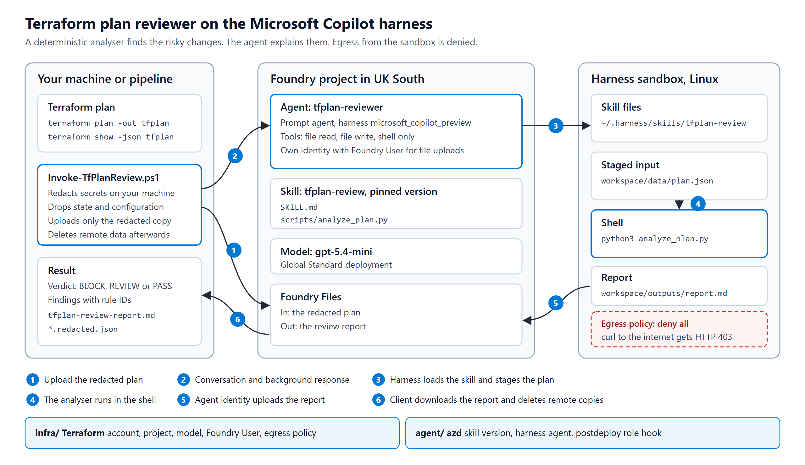

# Reviewing Terraform plans with the Microsoft Copilot harness in Foundry

On 28 October 2026 Microsoft released the [Microsoft Copilot harness](https://devblogs.microsoft.com/foundry/microsoft-copilot-harness-in-foundry/) in Foundry Agent Service as a public preview. The harness is a managed runtime for prompt agents. You still define a prompt agent with a model, instructions and tools. Foundry then runs it in a sandbox it manages, where the agent can load skills, read and write files, run shell commands and hand work to subagents.

Microsoft's example is a research agent. I wanted to see how the harness handles a job platform teams do every day, so this lab builds a Terraform plan reviewer. You give it the output of `terraform show -json`, it runs a deterministic analyser inside the sandbox, and it returns a report with a verdict of BLOCK, REVIEW or PASS.

I deployed and tested everything in this post in my own subscription in UK South. The [companion repository](https://github.com/jpsantoscosta/getpractical-copilot-harness-lab) holds the Terraform, the agent definition, the PowerShell client and 102 tests.



## What the harness adds to a prompt agent

The agent type does not change. A harness agent is still a prompt agent, you still call it through the Responses API, and Foundry project roles still control who can use it. The harness changes what happens when a request arrives.

Foundry gives each conversation its own workspace and an isolated Linux sandbox. The agent gets five built-in tools: file read, file write, shell, web fetch and subagents. Skills are versioned Foundry resources that hold a `SKILL.md` file plus any scripts and reference files the skill needs. The harness loads a skill when the task calls for it.

Microsoft's guidance on picking an approach is short:

| Approach | Use it when |
| --- | --- |
| Prompt agent without the harness | Instructions and the supported tools are enough |
| Prompt agent with the harness | You want skills, files, shell execution and subagents without operating the runtime yourself |
| Hosted agent | You need your own framework, agent loop, middleware or dependencies |

The preview has limits you should know before you design around it:

- You choose the harness when you create the agent. You cannot switch an existing agent to it.
- Foundry manages the sandbox CPU, memory and idle settings. You cannot change them.
- Every request needs a conversation. The harness rejects `store: false` and `previous_response_id`.
- Request fields the harness manages, such as `temperature`, `max_output_tokens` and `truncation`, return an error if you send them.
- The harness does not support bring your own model or Foundry Memory.
- It runs in nine regions: Australia East, Canada Central, Central US, Germany West Central, Japan East, Sweden Central, UK South, West Europe and West US.

## Why a Terraform plan reviewer

A plan for a real environment can run to hundreds of resources. The changes that hurt are easy to miss in that output: a rename that makes Terraform destroy a storage account, an NSG rule someone meant to remove after troubleshooting, a lock that disappeared because a `count` went to zero. A reviewer who skims a long plan can approve any of these without noticing.

An LLM on its own is the wrong tool for the detection part. It can miss a finding or invent one, and you cannot unit test its judgement. So the lab splits the work. A Python analyser finds the risky changes, the same way every time. The agent runs the analyser in the sandbox, explains each finding in Azure terms and suggests a Terraform-level fix. The analyser decides what is risky. The model writes the explanation.

The harness provides the parts this split needs. The analyser ships inside the skill, the sandbox has Python, and the agent runs the analyser with the shell tool. Without the harness you would have to host and secure that execution environment yourself.

## What you build

The lab has four parts:

- `infra/` is Terraform for the Foundry platform: account, project, model deployment, role assignment and an egress policy.
- `agent/` is an azd project that publishes the `tfplan-review` skill and creates the `tfplan-reviewer` agent on the harness.
- `client/` is a PowerShell module and script that redacts a plan on your machine, uploads it, runs the review and downloads the report.
- `tests/` holds the Python, Pester and Terraform tests, plus a live suite that runs against the deployed lab.

I used Terraform for the platform and azd for the agent on purpose. In most organisations a platform team owns the Foundry account and its guardrails, and application teams ship agents into it. azd is also the documented way to define harness agents as source-controlled files, so the agent definition matches Microsoft's examples.

I tested with Terraform 1.14.9, azurerm 5.12.0, azapi 2.13.0, azd 1.37.2 with the Foundry extensions `azure.ai.agents` 1.0.0-beta.23 and `azure.ai.skills` 1.0.0-beta.10, PowerShell 7.6, Pester 6.2 and the `gpt-5.4-mini` model, version 2026-03-17.

## Before you start

You need an Azure subscription where you can create resource groups, Foundry resources and role assignments. Owner on a lab subscription is the simple option.

Owner alone does not let you create agents. Owner covers the control plane, while agents, skills and conversations are data-plane operations. The identity that deploys and calls the agent needs the Foundry User role on the project, and the Terraform in this lab grants it. Foundry is renaming its roles from "Azure AI" to "Foundry", so the code assigns them by role definition ID. Foundry User is `53ca6127-db72-4b80-b1b0-d745d6d5456d`.

Install the Azure CLI, Terraform, PowerShell 7.4 or later, Pester 5 or later, Python 3.9 or later, and azd 1.37 or later with the Foundry extensions:

```powershell
winget install microsoft.azd
azd extension install microsoft.foundry
azd config set auth.useAzCliAuth true   # reuse your az login
$env:AZD_ALPHA_ENABLE_AGENTS_MANAGED_HARNESS = 'true'   # every new shell
```

Cost has two parts. The harness runtime is free until 1 December 2026. From then on, sandbox compute costs USD 0.0994 per vCPU-hour and USD 0.0118 per GiB-hour. You also pay your model deployment's normal token rates. One review in this lab took 30 to 40 seconds and used about 66,000 to 71,000 input tokens and 1,300 to 2,600 output tokens. The usage figure counts every model call the harness makes during a review, and in the run I measured, 93% of the input tokens came from the prompt cache. The Foundry account has no standing charge, so an idle lab costs nothing.

## Step 1. Build the platform with Terraform

The `infra/` folder creates a resource group, a Foundry account with project management enabled, a project, a `gpt-5.4-mini` Global Standard deployment, a role assignment for you, and a responsible AI policy that carries the network egress rules.

The account turns off key-based authentication, so every call uses Entra ID:

```hcl
resource "azurerm_cognitive_account" "foundry" {
  name                       = "aif-${local.name_stem}-${random_string.suffix.result}"
  kind                       = "AIServices"
  sku_name                   = "S0"
  custom_subdomain_name      = "aif-${local.name_stem}-${random_string.suffix.result}"
  project_management_enabled = true
  local_auth_enabled         = false
  # location, resource group, identity and tags omitted
}
```

The egress policy matters most for this agent. Terraform plans hold resource IDs, network layouts and sometimes secrets, so the sandbox should not be able to send data anywhere. The harness supports network egress controls in preview through a responsible AI policy. azurerm does not model the `egressPolicy` block yet, so the lab uses azapi with the 2026-05-15-preview API:

```hcl
resource "azapi_resource" "egress_policy" {
  type                      = "Microsoft.CognitiveServices/accounts/raiPolicies@2026-05-15-preview"
  name                      = "egress-lockdown"
  parent_id                 = azurerm_cognitive_account.foundry.id
  schema_validation_enabled = false

  body = {
    properties = {
      mode           = "Blocking"
      basePolicyName = "Microsoft.DefaultV2"
      contentFilters = []
      egressPolicy = {
        mode          = var.egress_mode   # "Enforced" or "Audit"
        defaultAction = "Deny"
        rules = [
          for index, host in var.egress_allowed_hosts : {
            name     = "allow-${index + 1}"
            ruleType = "Fqdn"
            match    = { host = host }
            action   = { actionType = "Allow" }
          }
        ]
      }
    }
  }
}
```

The default denies everything. Foundry keeps the connections the harness itself needs, so the agent still works. If your skills need a package index, add hosts such as `pypi.org` to `egress_allowed_hosts`. This analyser uses only the Python standard library, so the list stays empty.

Deploy it from `infra/`:

```powershell
Copy-Item terraform.tfvars.example terraform.tfvars   # then set subscription_id
terraform init
terraform test     # 8 offline tests against mocked providers
terraform apply
```

The `terraform test` suite mocks every provider, so it creates nothing. It checks that the account is AIServices with local auth off, that names follow the Cloud Adoption Framework pattern, that the deployment is `gpt-5.4-mini` on Global Standard, that the Foundry User assignment covers only the project, that egress defaults to Deny, and that a region without the harness fails validation.

UK readers should check data residency before sending real plans. In UK South, the model list shows `gpt-5.4-mini` with Global Standard, Global Batch and two provisioned throughput SKUs, one of them regional, and no Data Zone Standard option. Global Standard can process prompts in any Azure region. If your plans must stay in the UK, the regional provisioned SKU keeps processing in UK South, and Microsoft prices it for steady production load.

## Step 2. Write the skill

A skill is a folder with a `SKILL.md` at its root. This one also carries `scripts/analyze_plan.py`, so the folder looks like this:

```text
agent/skills/tfplan-review/
  SKILL.md
  scripts/
    analyze_plan.py
```

The analyser reads the JSON plan and applies eight rules:

| Rule | Severity | What the plan does |
| --- | --- | --- |
| TFR001 | high, or critical for stateful resources | Destroys a resource |
| TFR002 | high, or critical for stateful resources | Replaces a resource, and the finding names the attributes that force it |
| TFR003 | high | Turns on public network access |
| TFR004 | critical | Opens SSH or RDP to the internet |
| TFR005 | high, or critical at subscription or management group scope | Grants Owner, Contributor, User Access Administrator or RBAC Administrator |
| TFR006 | high | Removes a resource lock |
| TFR007 | low | Creates or updates a resource without a required tag |
| TFR008 | high | Allows anonymous blob access on a storage account |

Any critical finding gives BLOCK. Any high or medium finding gives REVIEW. Anything else is a PASS. The analyser prints full JSON, a Markdown table or a short summary block, and it never prints attribute values beyond the ones a rule needs, such as ports, address prefixes, role names and scopes.

`SKILL.md` tells the agent how to use it. This is the core of it:

```markdown
---
name: tfplan-review
description: Review a Terraform JSON plan (terraform show -json) for risky Azure changes and return a verdict, explained findings and a downloadable report.
---

## Steps

1. Find the plan: the `.json` file attached to the message. Do not edit it.
2. Run the analyser three times on it:

       python3 $SKILL/scripts/analyze_plan.py <plan.json>
       python3 $SKILL/scripts/analyze_plan.py <plan.json> --format markdown
       python3 $SKILL/scripts/analyze_plan.py <plan.json> --format summary

   If the analyser fails, say so and stop. Do not guess findings.
3. Never add, drop or re-grade findings yourself.
...
6. End the reply with the `--format summary` output, pasted exactly as printed.
```

The last step makes the reply machine-readable. The summary format prints a fenced block with the info string `tfplan-review-summary` and one line of JSON. The client parses that block, so a pipeline can act on the verdict without reading the prose. The analyser prints the block and the model only pastes it, so the model never composes the JSON the client parses.

I ran a diagnostic prompt against the deployed agent to see where everything lands. The sandbox is Linux on x86_64 with Python 3.13. Skills appear under `/home/session/.harness/skills/<name>/`, attached files land in `/home/session/workspace/data`, and the agent can return anything it writes to `/home/session/workspace/outputs` as a downloadable file. The skill file mentions these paths and also tells the agent to locate its own folder, in case the layout changes during the preview.

## Step 3. Define the agent in azure.yaml

The azd project points at the existing project that Terraform built, publishes the skill and creates the agent:

```yaml
services:
  ai-project:
    host: azure.ai.project
    endpoint: ${FOUNDRY_PROJECT_ENDPOINT}

  tfplan-review:
    host: azure.ai.skill
    uses:
      - ai-project
    archive: ./skills/tfplan-review

  tfplan-reviewer:
    host: azure.ai.agent
    project: .
    uses:
      - ai-project
      - tfplan-review
    kind: prompt
    name: tfplan-reviewer
    model: ${MODEL_DEPLOYMENT_NAME}
    harness:
      type: microsoft_copilot_preview
    skills:
      - tfplan-review
    tools:
      - type: microsoft_copilot_toolset_preview
        defaultConfig:
          enabled: false
        configs:
          - name: filesystem_read
            enabled: true
          - name: filesystem_write
            enabled: true
          - name: shell
            enabled: true
    policies:
      - type: rai_policy
        raiPolicyName: ${RAI_POLICY_ID}
```

Three settings matter here. `harness.type: microsoft_copilot_preview` selects the harness. The `microsoft_copilot_toolset_preview` block turns every built-in tool off and then turns on file read, file write and shell, so web fetch and subagents are off. The `policies` entry attaches the egress policy from Step 1.

The tool list is not enough on its own. Microsoft's documentation warns that shell can read and write files and reach the network, so turning off the file and web tools while shell is on is not a security boundary. The egress policy is the control that blocks traffic, and Step 7 tests it.

The agent also needs a role of its own. When the agent returns a file, the harness uploads it to Foundry Files as the agent's identity, and that identity needs Foundry User on the project. The identity only exists once azd has created the agent, so Terraform cannot grant it. A `postdeploy` hook in `azure.yaml` runs `hooks/assign-agent-role.ps1` after each deploy. The hook reads `instance_identity.principal_id` from the agent and assigns the role if it is missing. A new assignment can take up to five minutes to apply, and until then the file upload fails with HTTP 403.

## Step 4. Deploy with azd

`scripts/Sync-AzdEnv.ps1` copies the Terraform outputs into an azd environment. Each output name is upper case, so it matches the variable `azure.yaml` expects. Then deploy:

```powershell
./scripts/Sync-AzdEnv.ps1
cd agent
azd deploy --all --no-prompt
azd ai agent show tfplan-reviewer --output json
```

azd publishes the skill as an immutable version, creates the agent with that version pinned, and runs the hook. When I changed the skill and deployed again, azd published skill version 2 and created agent version 2 pinned to it. The JSON from `azd ai agent show` should list `kind: prompt`, `harness.type: microsoft_copilot_preview`, the skill with a version number, the toolset and the policy ID under `rai_config`.

If you work on Windows and your user profile path has a space in it, `azd ai agent invoke` fails straight away with `'C:\Users\<first-name>' is not recognized as an internal or external command`. In azd 1.37.2 the invoke command starts the agents extension in a way that breaks on the space. The other commands work. Pointing azd at the short 8.3 form of its config folder fixes it for the session:

```powershell
$env:AZD_CONFIG_DIR = (New-Object -ComObject Scripting.FileSystemObject).GetFolder("$HOME\.azd").ShortPath
```

The client in this lab calls the REST API without azd, so the bug does not affect it.

## Step 5. Produce a plan worth reviewing

The `demo/` folder holds a small workload: a resource group, an NSG, an empty storage account and a delete lock. A `scenario` variable switches it between a safe baseline and a risky change that you only ever plan:

```powershell
cd demo
terraform apply                                  # the baseline
terraform plan -var scenario=risky -out tfplan   # never apply this one
terraform show -json tfplan > plan.json
```

The risky scenario makes six bad changes: it renames the storage account, opens RDP from the internet, makes the account public with anonymous blob access, drops the `owner` tag, removes the lock and grants Owner on the resource group. Terraform summarises it like this:

```text
  # azurerm_management_lock.storage[0] will be destroyed
  # azurerm_network_security_rule.allow_rdp[0] will be created
  # azurerm_resource_group.demo will be updated in-place
  # azurerm_role_assignment.owner[0] will be created
  # azurerm_storage_account.demo must be replaced
Plan: 3 to add, 1 to change, 2 to destroy.
```

That summary does not tell you the replaced storage account loses its data, that the account is now public, or that the new role is Owner. Those details sit further down in the plan output.

## Step 6. Run the review

```powershell
./client/Invoke-TfPlanReview.ps1 -PlanPath ./demo/plan.json
```

The client works in five stages:

1. It reads the plan and builds a redacted copy. It keeps only the sections a review needs: resource changes, drift, output changes and variables. It drops `prior_state`, `planned_values` and `configuration`. It replaces every value Terraform marks as sensitive, every sensitive variable and any string stored under a secret-looking name such as `password`, `connection_string` or `clientSecret` with `(redacted)`.
2. It writes the redacted copy next to the outputs, so you can inspect the file that leaves your machine, and uploads that copy to the project's Files API.
3. It starts a conversation on the agent endpoint and sends one message with the file attached. The harness requires a conversation for every request.
4. It polls the background response, parses the `tfplan-review-summary` block and downloads the report the agent uploaded.
5. It deletes the uploaded plan, the report and the conversation from Foundry. `-KeepRemoteData` keeps them.

The calls are plain REST with an Entra token for `https://ai.azure.com`. Conversations and responses go to the agent's own endpoint and need a preview header:

```text
POST {project}/openai/v1/files                                                   upload the plan
POST {project}/agents/tfplan-reviewer/endpoint/protocols/openai/conversations?api-version=v1
POST {project}/agents/tfplan-reviewer/endpoint/protocols/openai/responses?api-version=v1
     Foundry-Features: MicrosoftCopilot=V1Preview
     { "conversation": { "id": "conv_..." }, "background": true,
       "input": [ { "role": "user", "content": [
         { "type": "input_text", "text": "Review the attached Terraform plan with the tfplan-review skill." },
         { "type": "input_file", "file_id": "assistant-..." } ] } ] }
```

Here is a real run against the risky plan. It took 41 seconds:

```text
Redacted 12 sensitive value(s) and dropped 5 plan section(s).

Verdict: BLOCK  (8 finding(s), 41s)
  critical TFR004  azurerm_network_security_rule.allow_rdp[0]
  critical TFR002  azurerm_storage_account.demo
  high     TFR001  azurerm_management_lock.storage[0]
  high     TFR006  azurerm_management_lock.storage[0]
  high     TFR005  azurerm_role_assignment.owner[0]
  high     TFR003  azurerm_storage_account.demo
  high     TFR008  azurerm_storage_account.demo
  low      TFR007  azurerm_storage_account.demo
Report: outputs/tfplan-review-report.md
```

The report pairs the analyser's table with the model's explanation. This is the agent's text for the storage account, unedited:

```text
azurerm_storage_account.demo — the storage account is being replaced because of a name
change, which means Terraform will destroy the existing account and create a new one. That
is risky on Azure because storage accounts often contain persistent application data, and a
replacement can lose blobs, queues, tables, and access configuration.

Safest Terraform-level fix: avoid the rename by using a `moved` block or preserving the
existing name; if replacement is unavoidable, migrate data first and protect the current
resource with `lifecycle { prevent_destroy = true }` until cutover is complete.
```

The response also records what the harness did. In this run the agent loaded the skill, ran the analyser in one shell script that wrote all three outputs to files, read them back with the file tool, wrote the report and uploaded it:

```text
skill: tfplan-review
shell: python3 "$SKILL/scripts/analyze_plan.py" "$PLAN" > "$OUTDIR/tfplan-review-full.json" ...
tool: view
tool: view
tool: view
tool: apply_patch
tool: upload_file_from_workspace_to_foundry_project
```

In an earlier run the agent made three separate shell calls instead. The steps vary between runs, and the findings stay the same because the analyser produces them.

## Step 7. Test it

The repository has four test suites. One script runs them all:

```powershell
./scripts/Invoke-LabTests.ps1 -Live
```

```text
Step                           Result Seconds Detail
----                           ------ ------- ------
Python analyser tests          PASS      0.80 OK
Pester unit tests              PASS      3.40 40 passed
terraform fmt                  PASS      0.10 formatted
terraform validate (infra)     PASS      2.10 Success! The configuration is valid.
terraform validate (demo)      PASS      1.30 Success! The configuration is valid.
terraform test (infra, mocked) PASS      1.20 Success! 8 passed, 0 failed.
Pester live tests              PASS     94.80 22 passed

All 7 steps passed.
```

The 32 Python tests cover every rule, the verdict logic and the output formats of the analyser. Four of them check real plans from the demo workload. Before I committed those plans, a sanitiser swapped the storage keys for fake ones and replaced the subscription, tenant and principal IDs with placeholder GUIDs, and one test fails if a committed plan contains any other GUID. The 40 Pester unit tests cover redaction, response parsing and the REST calls, with HTTP mocked. To check that the tests can fail, I broke the code on purpose. I turned off each redaction rule in turn, removed the internet sources from the NSG rule and changed severities, and in every case the matching test failed.

The live suite runs against the deployed lab. It checks the agent definition, runs full reviews of a small plan and of the real risky plan, and checks the cleanup. The analyser is the oracle. The test runs it on your machine against the same plan, and the agent's verdict, counts and findings must match its output. The test does not try to judge the model's prose.

The egress test asks the agent to run `curl` against `https://example.com` and reads the raw shell output from the response, not the model's description of it. To prove the test could fail, I switched the policy to `Audit` with `terraform apply -var egress_mode=Audit` and ran it in a new conversation:

```text
Describing Egress guardrail
  [+] ran curl from the harness sandbox
  [-] was refused by the egress policy with HTTP 403
   Expected regular expression '403' to match '200
```

After setting it back to `Enforced`:

```text
Describing Egress guardrail
  [+] ran curl from the harness sandbox
  [+] was refused by the egress policy with HTTP 403
```

Use a new conversation each time you test a policy change. A sandbox that is already running does not reload the policy.

## What I learned

Testing with a real plan exposed a redaction gap that my hand-written test data missed. My first redaction pass trusted Terraform's sensitivity markers. For `terraform_data`, Terraform marks `input.api_key` as sensitive and then repeats the same value in `output.api_key` with no marker. My demo used a stand-in value, but with a real secret the upload would have carried it. The client now records every value it redacts and then redacts any other string that contains one of them. To avoid wiping out common words, it does this only for values of eight characters or more. If you send plans to any external service, test your redaction against a real plan from your own providers.

The harness agent needs a role of its own. If file uploads fail with 403 while everything else works, check the Foundry User assignment for the agent's `instance_identity.principal_id`, and allow up to five minutes after you add it.

On Windows, `az` is a batch file, so cmd.exe parses its arguments. A JMESPath query with parentheses, such as `--query 'length(@)'`, fails with `--output was unexpected at this time`. Keep parentheses out of `--query` in PowerShell scripts that call `az`.

Plan for the token count. Each review used about 70,000 input tokens, even for the plan with three changes, so most of that is the harness's own context and not the plan. The prompt cache covered 93% of the input in the run I measured, but measure your own runs before you add this to every pipeline.

## Clean up

```powershell
cd agent; azd ai agent delete --force --no-prompt; azd ai skill delete tfplan-review --force --no-prompt
cd ../demo; terraform destroy
cd ../infra; terraform destroy
```

Deleting the Foundry account soft-deletes it. To reuse the same name straight away, purge it with `az cognitiveservices account purge`.

## Next steps

The obvious next step is to run the reviewer as a pull request check. A pipeline would run `terraform plan`, call `Invoke-TfPlanReview.ps1`, post the report as a comment and fail the check on BLOCK. That needs a service principal with Foundry User on the project and a federated credential for the pipeline, so no secret sits in the pipeline.

## Links

- [Introducing the Microsoft Copilot harness in Foundry Agent Service](https://devblogs.microsoft.com/foundry/microsoft-copilot-harness-in-foundry/), Microsoft Foundry Blog
- [Use the Microsoft Copilot harness with prompt agents](https://learn.microsoft.com/azure/foundry/agents/how-to/use-tools-skills-copilot-harness)
- [Use skills in Foundry](https://learn.microsoft.com/azure/foundry/agents/how-to/tools/skills)
- [Copilot harness limits and regions](https://learn.microsoft.com/azure/foundry/agents/concepts/limits-quotas-regions#microsoft-copilot-harness-preview)
- [Foundry samples for the Copilot harness](https://github.com/microsoft-foundry/foundry-samples/tree/main/samples/cli/prompt-agents/microsoft-copilot-harness)
- [Companion repository for this post](https://github.com/jpsantoscosta/getpractical-copilot-harness-lab)
